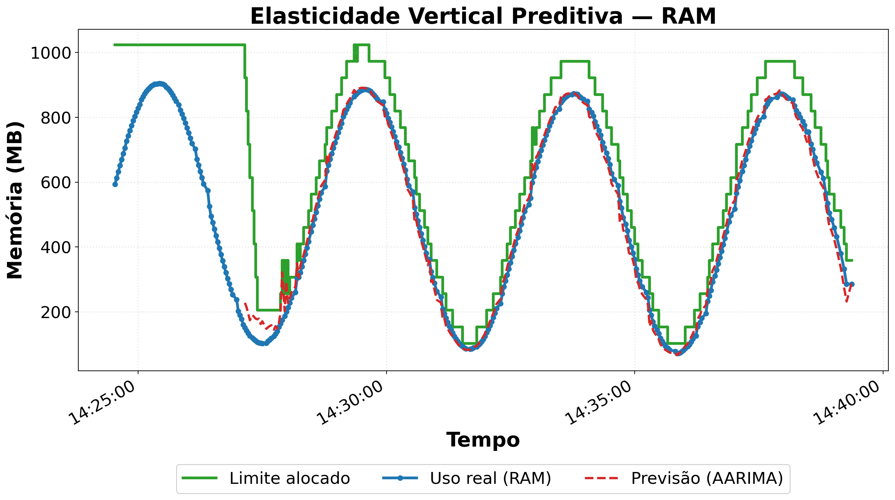
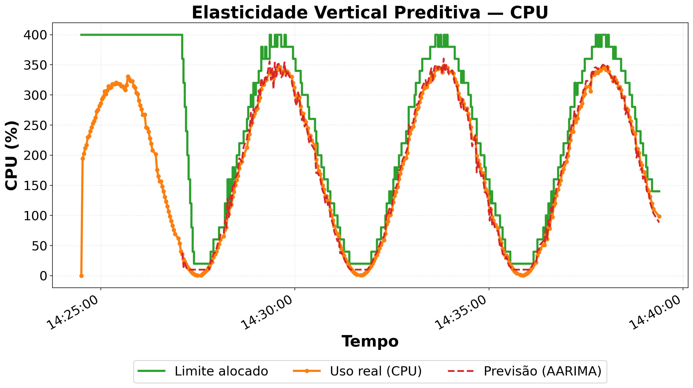

# Controlador de Elasticidade Vertical Preditiva em Contêineres Docker

Controlador que ajusta, em tempo de execução, os limites de RAM e CPU de contêineres Docker com base na previsão do uso, sem reiniciá-los. Evolução do projeto reativo desenvolvido anteriormente.

---

## O algoritmo

O controlador usa o AARIMA (*Adjusted ARIMA*, ARIMA ajustado) para prever o próximo valor de uso de cada recurso. A ideia vem de El Hag & Sharif (2007): a previsão do ARIMA recebe um termo de feedback (ajuste), calculado a partir da variação mais recente da série, que corrige parte do atraso do modelo diante de mudanças de tendência.

A cada 2 s, o uso é coletado via Glances e o ARIMA, ajustado sobre uma janela deslizante dos últimos 40 pontos, prevê o próximo valor. Essa previsão é somada ao termo de feedback: 0,5 × a variação mais recente da série (a diferença entre os dois últimos pontos se d = 0, ou a de segunda ordem se d ≥ 1).

Dois recursos auxiliam o ARIMA:

- Box-Cox: transforma a série antes do ajuste, para estabilizar a variância.
- auto ARIMA (`pmdarima`): escolhe a ordem (p, d, q), recalculada a cada N ciclos.

A previsão só começa depois de M amostras. Até lá, o limite fica no teto.

## Como o limite é calculado

A cada ciclo, o controlador define um novo limite a partir do maior valor entre o uso atual e a previsão:

```
base   = max(uso_atual, previsao)
alvo   = base * (1 + margem)                  # margem de X%
alvo   = arredonda_para_cima(alvo, passo)     # passo = Y% do teto do recurso
alvo   = clamp(alvo, minimo, teto)
```

- Se `alvo > limite atual`, o limite sobe direto para o alvo.
- Se `alvo < limite atual`, o limite desce no máximo P passos por decisão.
- Entre duas escalas há um intervalo mínimo de segundos.
- O limite é aplicado com `docker update` (`mem_limit` para RAM e `cpu_period`/`cpu_quota` para CPU).

Todos os parâmetros podem ser trocados por variáveis de ambiente (`MARGEM`, `PASSO_REL`, `MAX_PASSOS_RED`, `MIN_AMOSTRAS`, etc.), no início do `controlador.py`.

---

## Como executar

Requisitos: Docker, Python 3 e as dependências do projeto.

```bash
pip install -r requirements.txt
```

Para rodar um teste:

```bash
make build
make teste
```

- `make build` constrói as imagens dos geradores de carga (`gerador-ram` e `gerador-cpu`).
- `make teste` sobe os contêineres `carga-ram` e `carga-cpu`, executa o controlador sobre eles por ~15 minutos e, no final, gera as métricas e os gráficos.

Os resultados ficam em `logs/<contêiner>/`: logs da execução, `saida_metricas.txt` e o gráfico (`grafico_ram.png` e `grafico_cpu.png`).

---

## Resultados

Os resultados abaixo foram gerados com `make teste`: dois contêineres monitorados ao mesmo tempo, ambos com carga em onda senoidal.

### RAM



| Métrica | Valor |
|---|---|
| SMAPE | 4,515% |
| MAE | 11,03 MB |
| RMSE | 20,08 MB |
| Over-provisioning médio | 148,15 MB |
| Under-provisioning | 0 (em 379 ciclos) |
| Latência de escala (média) | 24,70 ms |
| Ações de escala | 113 |

### CPU



100% de CPU equivale a 1 núcleo.

| Métrica | Valor |
|---|---|
| SMAPE | 15,126% |
| MAE | 6,45% |
| RMSE | 8,42% |
| Over-provisioning médio | 60,52% |
| Under-provisioning | 0 (em 399 ciclos) |
| Latência de escala (média) | 41,29 ms |
| Ações de escala | 157 |

Em ambos os casos o uso real nunca ultrapassou o limite alocado, e o limite acompanha as subidas e descidas da carga.

---

## Pontos fortes

- Antecipa a demanda em vez de reagir depois da mudança.
- Não reinicia o contêiner.
- Nenhum under-provisioning no teste (política conservadora).
- O auto ARIMA escolhe a ordem do modelo sem ajuste manual.
- Escala RAM e CPU de vários contêineres ao mesmo tempo.
- Latência de escala baixa (dezenas de milissegundos).

## Pontos fracos

- Não há previsão durante o período de coleta de amostras, então o limite fica no teto.
- Over-provisioning elevado (consequência da política conservadora).
- Mudanças bruscas de padrão e cargas aleatórias são difíceis de prever para um modelo ARIMA.

---

## Referências

- Borja, B.E.L. & Ventura, M.E.M. (2020). *AutoRegressive Integrated Moving Average (ARIMA)*.
- Calheiros, R.N., Masoumi, E., Ranjan, R. & Buyya, R. (2014). *Workload Prediction Using ARIMA Model and Its Impact on Cloud Applications' QoS*. IEEE Transactions on Cloud Computing.
- El Hag, H.M.A. & Sharif, S.M. (2007). *An adjusted ARIMA model for internet traffic*. AFRICON 2007.
- Joshi, N.S. et al. (2024). *ARIMA-PID: container auto scaling based on predictive analysis and control theory*. Multimedia Tools and Applications 83, 26369-26386.
- Pmdarima (2025). *auto_arima documentation*.